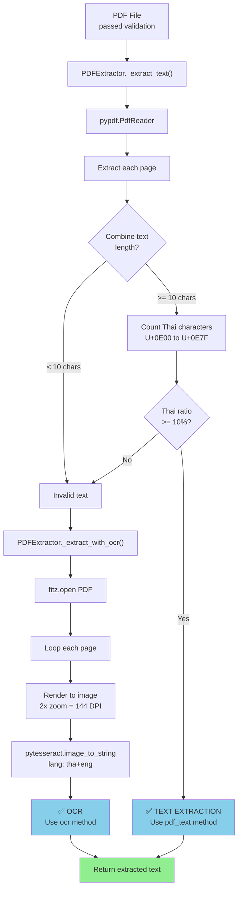
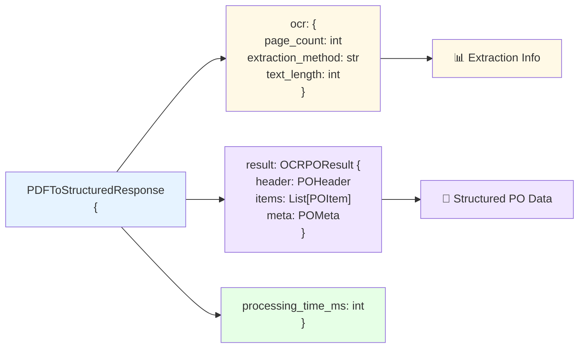
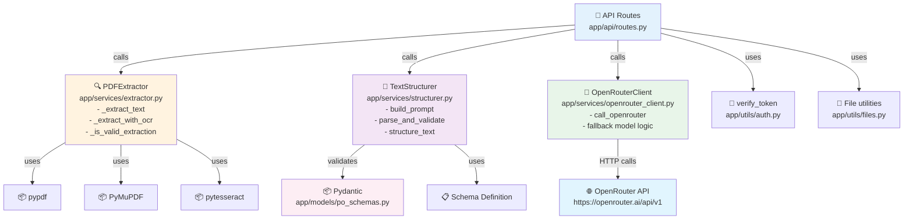
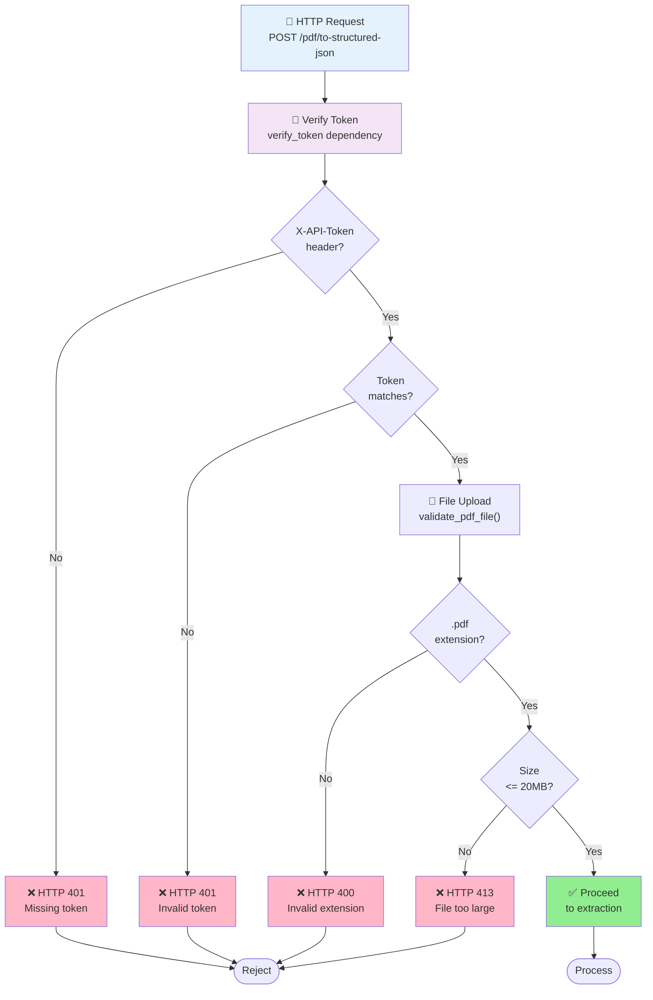
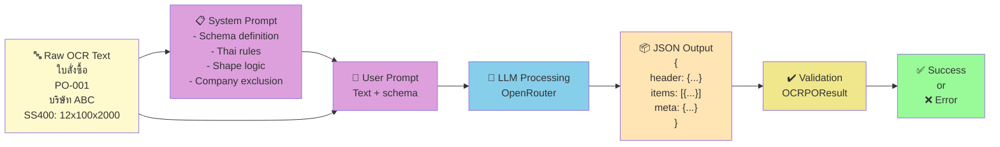

# Thai PDF OCR API - Current Flow Diagram (Mermaid Code)

## Endpoint: POST /pdf/to-structured-json (Main Pipeline)

````mermaid
flowchart TD
    Start([เริ่ม]) --> Upload["📤 Upload PDF File<br/>ผ่าน API Request"]

    Upload --> Validate["✅ Validate File<br/>- Size limit: 20MB<br/>- Extension: .pdf<br/>- Content-Type check"]

    Validate -->|Error| Error1["❌ HTTP 400/413<br/>Invalid file"]
    Error1 --> End1([สิ้นสุด])

    Validate -->|OK| SaveTemp["💾 Save Temp File<br/>ใน /tmp directory"]

    SaveTemp --> Extract["🔍 PDFExtractor.extract()"]

    Extract --> TryText["📄 Step 1: Text Extraction<br/>ลอง pypdf.PdfReader<br/>Extract page by page"]

    TryText --> CheckQuality["⚖️ Quality Check<br/>- ความยาว >= 10 chars<br/>- Thai ratio >= 10%"]

    CheckQuality -->|Valid Text| UsePDF["✅ ใช้ PDF Text Method<br/>method='pdf_text'"]

    CheckQuality -->|Invalid| FallbackOCR["🔄 Fallback to OCR<br/>Text ไม่พอให้ใช้ OCR"]

    FallbackOCR --> OCRProcess["🤖 OCR Processing<br/>- fitz render page to image<br/>- pytesseract + Thai lang<br/>- 2x zoom = 144 DPI"]

    OCRProcess --> UseTess["✅ ใช้ OCR Method<br/>method='ocr'"]

    UsePDF --> CombineText["📝 Combine Text<br/>text + pages list<br/>page_count"]

    UseTess --> CombineText

    CombineText --> BuildPrompt["🎨 Build LLM Prompt<br/>TextStructurer.build_prompt()"]

    BuildPrompt --> PromptDetail["📋 Prompt Format<br/>System: Schema definition<br/>+ Thai PO rules<br/>+ Company exclusion list<br/>User: Raw text"]

    PromptDetail --> CallLLM["🔗 Call OpenRouter API<br/>OpenRouterClient.call_openrouter()"]

    CallLLM --> LLMConfig["⚙️ LLM Configuration<br/>Model: gpt-4o-mini (default)<br/>Temp: 0.0<br/>Timeout: 60s"]

    LLMConfig --> LLMCall["📤 HTTP POST to OpenRouter<br/>Headers: Auth + Referer<br/>Body: messages + model"]

    LLMCall -->|No Response| Fallback["🔄 Try Fallback Models<br/>gpt-3.5-turbo<br/>claude-3-haiku<br/>gemini-pro"]

    Fallback -->|Success| LLMResp["📥 LLM Response<br/>Raw JSON string"]

    Fallback -->|Fail| Error2["❌ HTTP 502/504<br/>LLM Service Error"]

    Error2 --> Cleanup["🧹 Cleanup Temp"]
    Cleanup --> End2([สิ้นสุด])

    LLMCall -->|Success| LLMResp

    LLMResp --> ParseJSON["🔍 Parse JSON<br/>TextStructurer.parse_and_validate()"]

    ParseJSON --> CleanMarkdown["🧹 Clean Markdown Fence<br/>Remove ``` if present"]

    CleanMarkdown --> JSONParse["📦 JSON Parse<br/>json.loads()"]

    JSONParse -->|Parse Error| Error3["❌ HTTP 502<br/>Invalid JSON from LLM"]
    Error3 --> Cleanup

    JSONParse -->|Success| Validate2["✔️ Pydantic Validation<br/>OCRPOResult schema"]

    Validate2 -->|Validation Error| Error4["❌ HTTP 422<br/>Schema Mismatch"]
    Error4 --> Cleanup

    Validate2 -->|Success| Response["✅ Build Success Response<br/>PDFToStructuredResponse"]

    Response --> ResponseData["📊 Response Data<br/>- ocr: extraction metadata<br/>- result: structured PO<br/>- processing_time_ms"]

    ResponseData --> ReturnJSON["📤 Return JSON<br/>HTTP 200"]

    ReturnJSON --> Cleanup
    Cleanup --> End3([สิ้นสุด])

    style Start fill:#90EE90
    style End1 fill:#FFB6C6
    style End2 fill:#FFB6C6
    style End3 fill:#90EE90
    style Error1 fill:#FFB6C6
    style Error2 fill:#FFB6C6
    style Error3 fill:#FFB6C6
    style Error4 fill:#FFB6C6
    style UsePDF fill:#87CEEB
    style UseTess fill:#87CEEB
    style Response fill:#DDA0DD
    style ReturnJSON fill:#DDA0DD
````

---

## Detailed: Text Extraction Decision Logic



---

## API Response Structure



---

## Service Layer Architecture



---

## Authentication & Validation Flow



---

## Data Flow: From OCR Text to Structured PO


